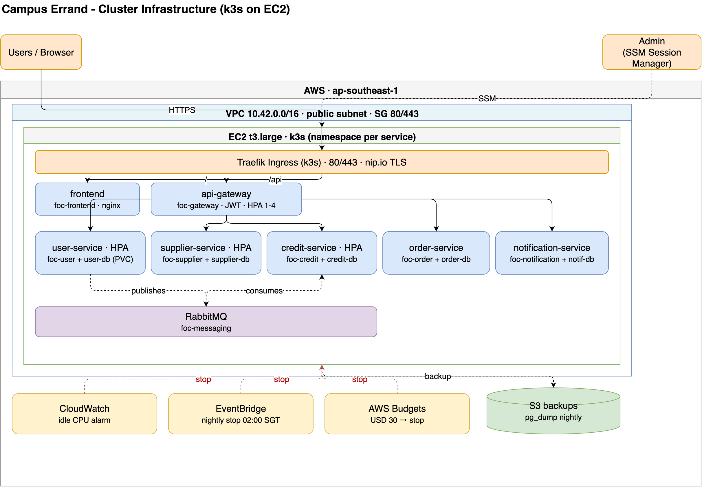

# Deployment

## Cluster infrastructure (Kubernetes on EC2)



Editable source: [`cluster-infrastructure.drawio`](cluster-infrastructure.drawio), also exported as [SVG](cluster-infrastructure.svg). The Helm charts and Terraform live in [`infra/`](../infra).

## Local (mandatory - project M7)

The whole system runs locally via Docker Compose:

```bash
cp .env.example .env
make up      # build + start all services, DBs, and RabbitMQ
make ps      # verify health
make down
```

- Frontend: <http://localhost:5173>
- API Gateway: <http://localhost:8080>
- RabbitMQ management: <http://localhost:15672>

## TLS / transport security (backlog N1)

Backlog N1 requires encrypted transport.
For local dev this is documented but not enforced.
On the EC2 GitOps deployment TLS is enforced: Traefik terminates TLS at the ingress with Let's Encrypt certificates issued by cert-manager (see the Cloud deployment section below).
For any other hardened deployment, terminate TLS at the gateway (or an ingress/reverse proxy in front of it) and reject plaintext.

## Cloud deployment (GitOps with ArgoCD)

The EC2 cluster is deployed with GitOps: the main branch is the single source of truth, and ArgoCD continuously syncs the cluster to whatever is committed there.

The delivery flow is:

1. A change is pushed and opened as a pull request; CI lints, tests, runs the Compose and k3d end-to-end suites, and scans every image.
2. On merge to `main`, CI builds the eight images, scans them with Trivy, and pushes SHA-tagged images to GHCR.
3. A `tag-bump` job then commits the new SHAs into `infra/helm/foc/values-ec2.yaml` with a `[skip ci]` message.
4. ArgoCD sees the new commit and syncs the cluster to it, so a merge to `main` is a deploy.

TLS on EC2 is terminated by Traefik with Let's Encrypt certificates issued by cert-manager, so transport is encrypted end to end at the ingress.

The full runbook (architecture, first-time bootstrap, day-2 operations, required status checks, and the Sealed Secrets workflow) lives in [`infra/argocd/README.md`](../infra/argocd/README.md).
The decision record for this setup is [`docs/adr/0002-gitops-with-argocd.md`](adr/0002-gitops-with-argocd.md).
