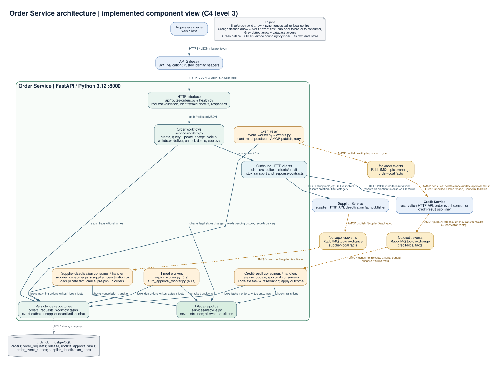
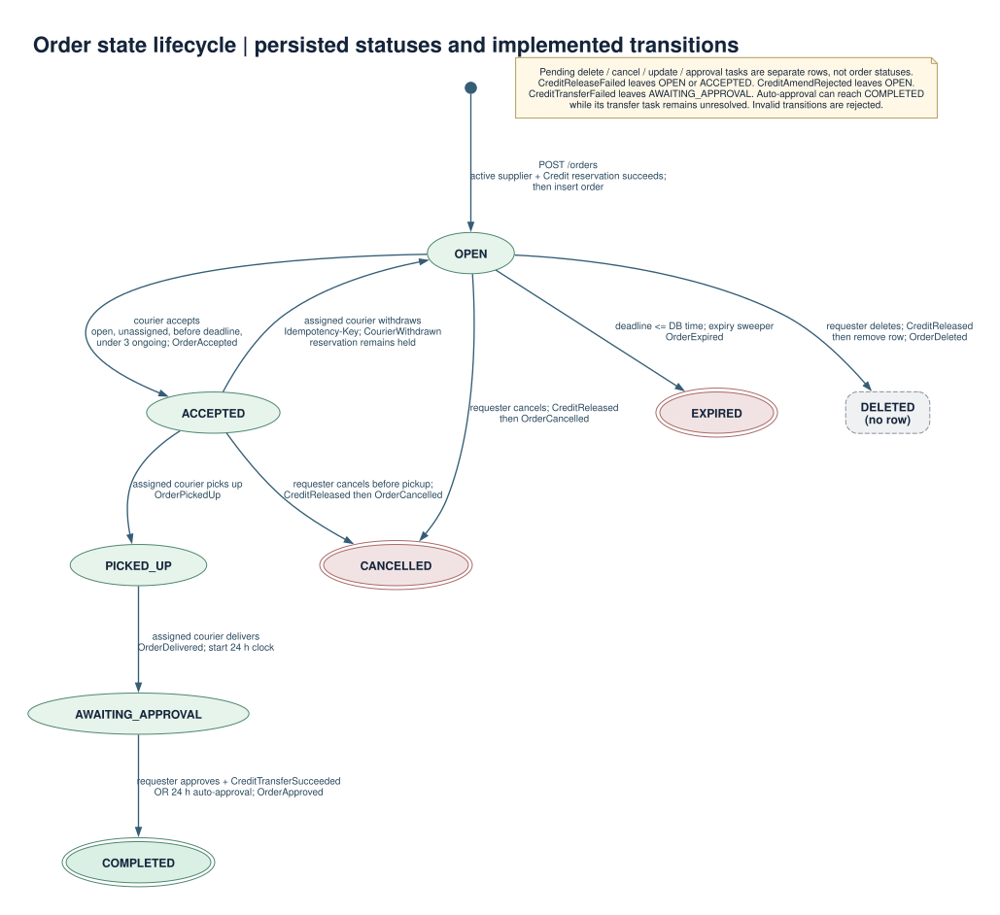

<!-- AI-INFLUENCED: Order Service architecture and lifecycle diagrams documented with Codex from the implemented services and supplied course materials. -->

# Order Service architecture and order lifecycle

These diagrams describe the **current order-service codebase**, using the supplied credit-service zip as the external integration reference. They are component and state views of implemented behavior, not a proposal to change service responsibilities. The component view follows the course's architecture definition (components, externally visible behavior, and relationships), the L6 diagram guidelines (title, legend, explicit elements, directional labels), and Tutorial 3's distinction between control flow and data flow.

## Component architecture (C4 level 3)

[Editable Graphviz source](./order-service-architecture.dot)

**Scope.** The green boundary is the single FastAPI Order Service process. The blue boxes are external interfaces or services; the yellow boxes are RabbitMQ topic exchanges; the cylinder is the Order Service's own PostgreSQL database. The diagram shows source-level components inside Order Service, not the internal design of Credit or Supplier Service.

| Notation | Meaning |
| --- | --- |
| Solid blue arrow | Synchronous HTTP call or local control call; its label states the operation or purpose. |
| Orange dashed arrow | Asynchronous AMQP event publication or consumption; the arrow follows data movement through the broker. |
| Grey dotted arrow | Data access to the service-owned database. |
| Purple dashed note | A contract mismatch in the supplied credit zip, not a working integration path. |
| Green outline around internal components | Order Service deployment/component boundary. |

**Acronyms.** C4 = Context, Container, Component, Code; API = application programming interface; HTTP = Hypertext Transfer Protocol; JSON = JavaScript Object Notation; AMQP = Advanced Message Queuing Protocol; JWT = JSON Web Token.

### Components and responsibilities

| Component | Implemented responsibility |
| --- | --- |
| `app/main.py` | Starts the API, three credit-result consumers, the event relay, and the two timed workers; closes them on shutdown. |
| `app/api/routes/orders.py`, `health.py` | Exposes order creation, discovery, assignment, pickup, withdrawal, delivery, update, deletion, cancellation, approval, task polling, and health. Reads gateway-injected identity headers. |
| `app/services/orders.py` | Applies order use cases and authorization/eligibility checks; saves order changes together with local task and outbox records where applicable. |
| `app/services/lifecycle.py` | Defines seven persisted statuses and the allowed status changes. |
| `app/services/clients/` | Uses `httpx` for Supplier lookup/category search and Credit reservation. If order insertion fails after reservation, calls Credit's release API as compensation. |
| `app/repositories/`, `app/models/`, `app/db.py` | Owns PostgreSQL access to `orders`, idempotent withdrawal requests, release/update/approval tasks, and `order_event_outbox`. Other services do not access these tables. |
| `expiry_worker.py`, `auto_approval_worker.py` | Every 5 seconds, expires due `OPEN` orders; every 60 seconds, completes due `AWAITING_APPROVAL` orders after 24 hours. Both write status and outbox facts atomically. |
| `release_consumer.py`, `update_consumer.py`, `approval_consumer.py` and corresponding handlers | Bind dedicated queues on `foc.credit.events`, correlate credit results with pending local tasks, and commit the resulting order/task changes before acknowledging. |
| `event_worker.py`, `events.py` | Reads committed outbox records, publishes persistent JSON messages to `foc.order.events` with event type as routing key, confirms publication, and retries failures. |

### External relationships and event contracts

| Direction | Protocol / contract | Meaning in the current code |
| --- | --- | --- |
| Web client → API Gateway → Order API | HTTPS/HTTP JSON; bearer JWT at gateway; `X-User-Id` and `X-User-Role` forwarded to Order | Gateway is the public entry point. Order uses the injected identity for its local access checks. |
| Order → Supplier | HTTP `GET /suppliers/{id}`, `GET /suppliers` | Validate the supplier on creation and obtain supplier IDs for category filtering. |
| Order → Credit | HTTP `POST /credits/reservations`; `POST /credits/reservations/{id}/release` only after failed local insertion | Reserve the reward before an order becomes `OPEN`; compensate if the Order DB write fails. Normal cancel/delete/update/approve workflows use events. |
| Order → `foc.order.events` | AMQP topic via transactional outbox | Publishes **facts about Order Service's own state or recorded local requests**. The broker routes them; each subscriber chooses its own response. |
| `foc.order.events` → supplied Credit Service | AMQP bindings | Credit consumes `OrderDeletionRequested`, `OrderCancellationRequested`, `OrderUpdateRequested`, `OrderExpired`, and `CourierWithdrawn`; it also binds `OrderCompleted`, which this Order Service does not emit. |
| Supplied Credit Service → `foc.credit.events` → Order | AMQP topic and three Order-owned queues | Credit publishes `CreditReleased`/`CreditReleaseFailed` and `CreditAmended`/`CreditAmendRejected`; Order correlates these to pending local tasks. Credit also publishes reservation outcomes, but Order does not subscribe to them. |

The outbound Order event set implemented by the relay is:

| Order fact group | Event types |
| --- | --- |
| Lifecycle | `OrderAccepted`, `OrderPickedUp`, `CourierWithdrawn`, `OrderDelivered`, `OrderCancelled`, `OrderExpired` |
| Pending cancel/delete and outcomes | `OrderCancellationRequested`, `OrderDeletionRequested`, `OrderCancellationFailed`, `OrderDeleted`, `OrderDeletionFailed` |
| Update task and outcome | `OrderUpdateRequested`, `OrderUpdated`, `OrderUpdateFailed` |
| Approval task and outcome | `OrderApprovalRequested`, `OrderApproved`, `OrderApprovalFailed` |

The `*Requested` names describe a request **recorded by Order Service**. The published message does not contain an instruction telling Credit Service what action it must take. Credit's own consumer independently decides how to handle a subscribed fact and publishes facts about its own credit result. `OrderExpiryRequested` is present in an Order-side schema but is not emitted by the expiry worker; it emits `OrderExpired` directly. `OrderCompleted` exists in the shared enum but this Order Service emits `OrderApproved` when completing an order.

No Supplier deactivation-event consumer is started by `app/main.py`, so a supplier-deactivation cascade is not part of this implemented component view.

**Approval integration gap.** Order Service publishes `OrderApprovalRequested` and binds `CreditTransferSucceeded`/`CreditTransferFailed` in its approval-result queue. The supplied credit zip has no `OrderApprovalRequested` binding or transfer-result publisher. Therefore requester-triggered approval remains pending with this exact pair of codebases. The Order Service's 24-hour auto-approval can still set the order to `COMPLETED`, while its transfer task remains unresolved. The diagram deliberately marks this as a gap rather than drawing a working Credit-to-Order transfer result.

## Finite state machine: persisted order status

[Editable Graphviz source](./order-state-machine.dot)

The ovals are exactly the seven values stored in `orders.status`. A double oval is terminal. The initial dot is an order that has not yet been stored; the dashed `DELETED (no row)` box is an outcome of hard deletion, **not** an eighth status. The text on an arrow gives its trigger, guard or required result, and the Order fact emitted after the change. Any transition absent from the diagram is rejected by `assert_transition` or the surrounding use-case guards.

| From → to | Trigger and condition | Order-side fact |
| --- | --- | --- |
| New → `OPEN` | `POST /orders`; supplier exists and is active; Credit reservation succeeds; Order row commits | No `OrderCreated` event is emitted. |
| `OPEN` → `ACCEPTED` | A different client accepts before deadline; no assigned courier or pending edit/deletion; courier has fewer than three ongoing orders | `OrderAccepted` |
| `ACCEPTED` → `OPEN` | Assigned courier withdraws with an idempotency key; reservation stays held | `CourierWithdrawn` |
| `ACCEPTED` → `PICKED_UP` | Assigned courier picks up; no pending terminal action | `OrderPickedUp` |
| `PICKED_UP` → `AWAITING_APPROVAL` | Assigned courier delivers; sets `awaiting_approval_at` | `OrderDelivered` |
| `AWAITING_APPROVAL` → `COMPLETED` | Requester approval **after** a matching `CreditTransferSucceeded` result, or local auto-approval once 24 hours have elapsed | `OrderApproved` |
| `OPEN`/`ACCEPTED` → `CANCELLED` | Requester starts cancellation; status changes only after matching `CreditReleased` | `OrderCancellationRequested`, then `OrderCancelled` |
| `OPEN` → `EXPIRED` | Deadline reaches database time; expiry sweeper locks and rechecks the row | `OrderExpired` |
| `OPEN` → deleted row | Requester starts deletion while unassigned; row removed only after matching `CreditReleased` | `OrderDeletionRequested`, then `OrderDeleted` |

Pending cancellation, deletion, update, and approval are **task records**, not order statuses. `CreditReleaseFailed` leaves the existing `OPEN`/`ACCEPTED` order in place and records an Order failure fact. `CreditAmended` changes editable fields while the order stays `OPEN`; `CreditAmendRejected` leaves those fields unchanged. A transfer failure leaves a requester-approved order in `AWAITING_APPROVAL`; a later automatic approval may still complete it. The expiry sweeper checks `OPEN` and deadline, even if a separate task is pending. `COMPLETED`, `CANCELLED`, and `EXPIRED` have no outgoing status transitions in the policy.

### Evidence used

- Course archive: `LectureSlides/L4-Architecture.pdf` (software architecture definition, page 4); `LectureSlides/L6-Architecture.pdf` (diagram purpose and guidelines, pages 27–31); `Tutorials/CS3219 Tutorial 3 Wk5.pdf` (component diagram question, page 1); `Tutorial Solutions/CS3219 Tutorial 3 Solutions.pdf` (component example and control/data-flow distinction, pages 3–4).
- Current repository: `app/main.py`, `app/api/routes/orders.py`, `app/services/`, `app/models/`, `app/repositories/`, and `app/config.py` under `order-service/`; the shared `foc_shared.events` event enum.
- Supplied zip: `credit-service/app/services/consumer.py`, `publisher.py`, `api/routes/credits.py`, `schemas/interop.py`, and `config.py` under `FoC-31-implementation-credit-service/`.

Regenerate the vector images from their editable sources with `dot -Tsvg order-service/docs/order-service-architecture.dot -o order-service/docs/order-service-architecture.svg` and the equivalent command for `order-state-machine.dot`.
